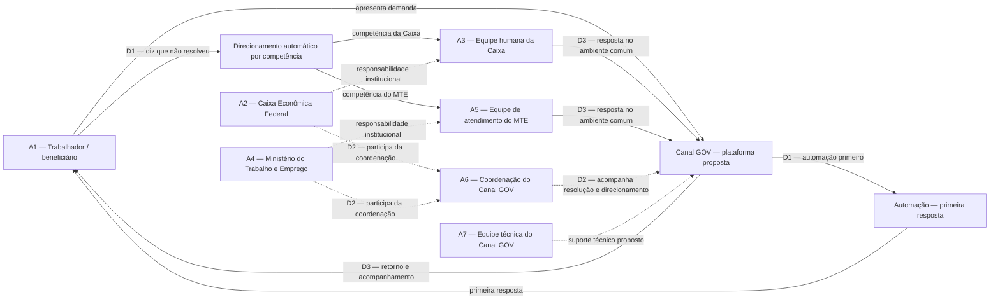
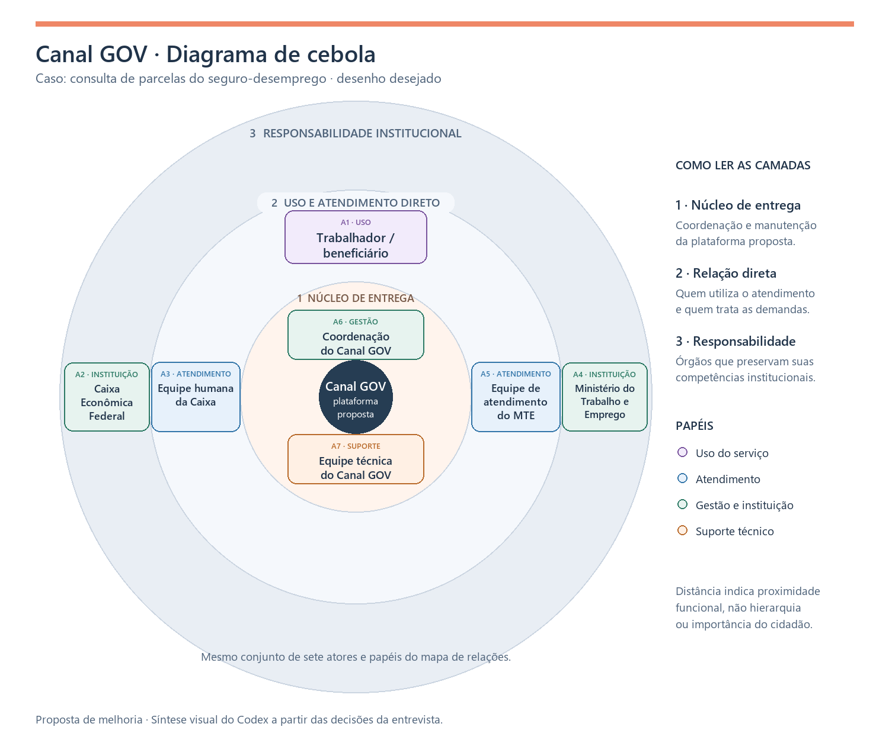

# Mapa de atores — seguro-desemprego: do Caixa Cidadão à proposta Canal GOV

Aluno: Lucimar Oliveira do Nascimento. Base documental: B_relatorio_assistente_v3.md. Base decisória: 13 rodadas reais de C_grill_transcript.md, encerradas com confirmação do aluno, e uma 14ª rodada de esclarecimento nominal. Síntese e desenho: Codex.

## Serviço, finalidade e fronteira

Nota de cronologia: o mapa foi decidido com a pesquisa v3 do ciclo anterior, preservada no commit f3e6086498687939dd21f295ffed356e0d711664. O novo ciclo ampliou a pesquisa documental posteriormente; os sete papéis e as escolhas do aluno permanecem iguais. Não foram acrescentados como decisões suas atores ou relações descobertos após a entrevista.

O caso concreto é a busca de informação sobre parcelas do seguro-desemprego pelo atendimento telefônico Caixa Cidadão, referido no exercício como URA da Caixa. A finalidade escolhida é reduzir o tempo gasto pelo trabalhador repetindo contatos quando sua dúvida não é resolvida. A fronteira vai da tentativa de consulta até uma orientação útil, sem análise completa da concessão (rodadas 1–3).

A entrevista produziu uma proposta de melhoria: **Canal GOV**, plataforma comum de atendimento, com direcionamento automático, tratamento pelas equipes competentes e retorno ao cidadão no mesmo ambiente (rodadas 7–10). É nome e desenho propostos pelo aluno. Não afirmamos que exista essa plataforma nem que corresponda à conta ou infraestrutura atual gov.br. Atender todas as demandas de governo é uma visão; este exercício detalha apenas o caso do seguro-desemprego.

## Atendimento documentado e desenho proposto

| Base atual da pesquisa v3 | Limite da evidência | Escolha da entrevista |
|---|---|---|
| Caixa divulga consulta telefônica de parcelas e oferta eletrônica/humana | Menus, acesso efetivo ao humano por demanda e arquitetura não observados | Automação primeiro; humano quando o cidadão disser que a resposta não resolveu — rodadas 4–5 |
| Caixa se apresenta como agente pagador; MTE responde pelo serviço federal de solicitação | Integração de dados, ligação e protocolo não comprovada | Equipes Caixa e MTE atuam no ambiente comum, mantidas suas competências — rodadas 8–10 |
| SAC e Ouvidoria são canais institucionais | Seu percurso pela plataforma proposta não foi demonstrado | Discutidos na rodada 9, sem aprovação de sequência obrigatória |
| Nenhuma unidade gestora ou operadora de plataforma conjunta foi identificada | Autoridade, fornecedor, contrato e viabilidade desconhecidos | Coordenação conjunta proposta; papel técnico apresentado para discutir riscos — rodadas 11–12 |

Fontes e limitações estão na v3: F1/F2/F4/F5 foram recuperadas por busca em domínio oficial, sem abertura integral bem-sucedida; F3/F6 tiveram leitura direta. As auditorias do Gemini são pareceres críticos textuais; não comprovam verificação externa independente.

## Sete atores ou papéis distintos

São pessoas, organizações e funções diferenciadas no desenho, não sete instituições independentes. Canal GOV, automação e roteamento são componentes e não entram na contagem.

| ID | Ator/papel | Tipo e camada | Papel no desenho desejado | Rastreabilidade e condição |
|---|---|---|---|---|
| A1 | Trabalhador ou beneficiário | Pessoa usuária; centro do serviço | Apresenta dúvida, informa que a resposta não resolveu e recebe orientação no mesmo ambiente | Rodadas 1–5; necessidade escolhida, sem pesquisa de campo com usuários |
| A2 | Caixa Econômica Federal | Organização; responsabilidade institucional | Responde por suas atribuições e participa da coordenação do atendimento comum | Rodadas 6, 8, 10–11; agente pagador em F5 |
| A3 | Equipe humana da Caixa / Caixa Cidadão | Papel operacional interno à Caixa | Trata demandas de sua competência após insuficiência da resposta automática e retorna pelo ambiente comum | Rodadas 4–5 e 8–10; atuação no Canal GOV é proposta |
| A4 | Ministério do Trabalho e Emprego (MTE) | Órgão público; responsabilidade administrativa | Mantém atribuições do serviço federal e participa da coordenação | Rodadas 7–11; responsabilidade pelo serviço em F3 |
| A5 | Equipe de atendimento do MTE | Papel operacional interno ao MTE | Recebe e trata assuntos de sua competência dentro do ambiente comum | Equipes discutidas nas rodadas 8 e 10 e papel confirmado nominalmente na rodada 14; unidade e vínculo não identificados; função do desenho proposto |
| A6 | Coordenação do Canal GOV, com participação da Caixa e do MTE | Governança proposta | Acompanha demandas sem solução e encaminhamentos errados; coordena o percurso conjunto | Rodada 11, reiterada na 12 e síntese na 13; não presumida autoridade existente |
| A7 | Equipe técnica do Canal GOV | Suporte técnico proposto | Manutenção da plataforma; suporte à investigação e correção técnica de roteamento é recomendação de implementação do Codex | Mencionada na rodada 12; aluno priorizou encaminhamento errado; atribuições detalhadas, composição e fornecedor abertos |

A3 pertence a A2; A5 pertence a A4. A6 não absorve as competências desses órgãos. A7 não decide o direito ao benefício. A gestão do Caixa Cidadão, aceita na rodada 6, é a responsabilidade local da Caixa; a rodada 11 acrescenta a coordenação conjunta para o desenho ampliado.

## Decisões tomadas durante o grill e incorporadas ao mapa

As decisões D1–D3 abaixo foram tomadas pelo aluno durante a entrevista registrada em [C_grill_transcript.md](C_grill_transcript.md). Cada linha identifica a pergunta, a resposta e a consequência no desenho. Os mesmos identificadores aparecem nas setas do diagrama a seguir.

| Decisão tomada no grill | Evidência da escolha do aluno | Consequência concreta no mapa |
|---|---|---|
| **D1 — Automação primeiro; atendimento humano quando o trabalhador disser que a resposta não resolveu.** | **Rodada 4:** “não concordo. A automação deveria responder primeiro e depois a equipe humana.” **Rodada 5:** o aluno respondeu `2\.`, escolhendo a alternativa “Quando o trabalhador disser que a resposta não resolveu sua dúvida.” A escolha foi a alternativa 2, e não a recomendação do entrevistador de aceitar as três situações. | A1 recebe a primeira resposta da automação (`P → AU → U`). Se declarar que não resolveu, sua manifestação aciona o direcionamento por competência para A3 ou A5 (`U → RT → EC/EM`). A seta de saída de A1 traz o critério aprovado; outros critérios para atendimento humano permanecem em aberto. |
| **D2 — Coordenação do Canal GOV com participação da Caixa e do MTE, preservadas as responsabilidades de cada órgão.** | **Rodada 11:** o entrevistador propôs essa forma de gestão. **Rodada 12:** o aluno aprovou expressamente a pergunta anterior: “pergunta 11. Concordo com a sugestão.” A aprovação também integra a síntese confirmada na rodada 13. A resposta da rodada 11 corrigia “iso” da rodada 10; por isso a concordância explícita com a coordenação é localizada na rodada 12. | A6 coordena o percurso conjunto, com participação institucional de A2 e A4 (`CX → CO` e `MT → CO`), e acompanha resolução e direcionamento (`CO → P`). A2 continua responsável por A3 e A4 por A5. A coordenação é uma função proposta; sua autoridade formal não foi estabelecida pela entrevista. |
| **D3 — Ambiente comum de atendimento, com direcionamento interno e resposta ao cidadão no mesmo lugar.** | **Rodada 9:** “O Canal GOV deveria redirecionar automaticamente o problema, sem que o cidadão precise saber quem orientará.” **Rodada 10:** o entrevistador explicitou o tratamento dentro de uma plataforma comum; o aluno respondeu “iso”, corrigindo para “isso” na rodada 11. A síntese foi confirmada na rodada 13. | A3 e A5 recebem as demandas pelo roteador e devolvem a resposta pela plataforma comum (`RT → EC/EM → P → U`). A1 não precisa identificar previamente o órgão competente. Essa decisão unifica o ambiente de atendimento; não determina substituir sistemas internos de pagamento ou concessão. |

**Confirmação final, rodada 13:** após a síntese das escolhas, o aluno respondeu: “Representa sim, a proposta que pensei.” Assim, o fluxo registra decisões da entrevista, e não somente atores extraídos da pesquisa. As atribuições técnicas adicionais e as hipóteses de implementação continuam identificadas como síntese do Codex.

## Diagrama de relações do desenho desejado

**Legenda:** todas as relações de integração abaixo são propostas, não observações da operação atual. Setas contínuas: jornada desejada. Pontilhadas: responsabilidade institucional, governança e suporte. A tecnologia de classificação não foi escolhida; não se presume IA generativa.

## Diagrama de cebola — proximidade e papel no serviço

[Versão vetorial para ampliar ou imprimir](assets/diagrama-cebola-canal-gov.svg).

Leitura complementar ao fluxo: o centro representa a plataforma proposta, não um oitavo ator. Os anéis indicam proximidade funcional com a entrega do atendimento, não hierarquia, poder ou importância do cidadão. As cores distinguem uso, atendimento, gestão/instituição e suporte técnico. É uma síntese visual do Codex com os mesmos sete atores e papéis já discutidos, sem introduzir decisões novas atribuídas ao aluno.

| Camada | Atores/papéis | Critério de posicionamento |
|---|---|---|
| Núcleo de entrega | A6 — Coordenação do Canal GOV; A7 — Equipe técnica do Canal GOV | Coordenam ou sustentam diretamente a plataforma comum proposta; composição e competências detalhadas continuam pendentes. |
| Uso e atendimento direto | A1 — Trabalhador/beneficiário; A3 — Equipe humana da Caixa; A5 — Equipe de atendimento do MTE | Usam o serviço ou tratam a demanda no ambiente comum. O trabalhador mantém centralidade na finalidade do desenho. |
| Responsabilidade institucional | A2 — Caixa Econômica Federal; A4 — Ministério do Trabalho e Emprego | Preservam atribuições institucionais e participam da coordenação proposta; suas equipes estão na camada de atendimento. |

As organizações e suas equipes aparecem em camadas diferentes por terem papéis distintos; não são instituições independentes. A camada externa não significa ausência de contato com o cidadão, mas o papel institucional representado neste desenho.

Na cebola, **D1** corresponde aos papéis de atendimento A3/A5, acionados pelo critério escolhido por A1; **D2** aparece em A6 no núcleo e na participação institucional de A2/A4; **D3** explica por que as duas equipes se vinculam à mesma plataforma central. As evidências dessas decisões estão na tabela anterior ao fluxo. Os anéis complementam o mapa de relações, sem representar uma sequência de atendimento.

O modelo visual foi inspirado no exemplo de diagrama de cebola do GOV.UK Design System (2017) apresentado na imagem da aula enviada pelo aluno. A classificação específica acima é uma adaptação ao exercício, não uma reprodução das categorias ou dos atores daquele caso. Os componentes e atores de contexto que ficaram fora do mapa original não foram acrescentados para preencher anéis. O diagrama ajuda a conferir a distribuição dos papéis e sua correspondência com o fluxo; não comprova integração implantada.

O encaminhamento incorreto não deve forçar a pessoa a sair da plataforma ou repetir sua história. O acompanhamento decorre das rodadas 8, 11 e 12; mecanismos de protocolo, histórico e prazo ainda precisam de projeto. Não foram inventados tempos de espera, indicadores, contratos, menus ou unidades administrativas.

## Influência e interesses a validar

Esta análise é uma hipótese do Codex para implementação, não resultado medido ou fala do aluno. Caixa e MTE têm competências institucionais relevantes e precisam participar das decisões. A coordenação precisaria de mandato e mecanismos para resolver impasses; a entrevista não cria essa autoridade. As equipes operacionais podem contribuir com conhecimento sobre as demandas e devem ser consultadas. O cidadão tem interesse direto na resolução, mas menor controle institucional: sua declaração de que a resposta não resolveu deve produzir consequência no percurso. A equipe técnica influencia viabilidade e estabilidade, sem decidir conteúdo administrativo do benefício.

Possíveis tensões incluem divisão de responsabilidades, capacidade das equipes e critérios de roteamento. Não se atribui resistência real a nenhum órgão sem evidência. A prioridade expressa é evitar encaminhamento errado. Como verificação futura, propõe-se medir redirecionamentos e necessidade de novos contatos; não existe linha de base nem meta numérica definida.

## Decisões, exclusões e pendências

- Rodadas 4–5: automação antes do humano; critério aprovado é o cidadão dizer que a resposta não resolveu. Outros critérios de acesso humano precisam de avaliação posterior.
- Rodadas 9–10: plataforma comum para tratamento, além de uma entrada com links. A substituição dos sistemas internos de pagamento ou concessão não foi decidida.
- SAC e Ouvidoria foram discutidos nominalmente na rodada 9, mas a concordância parcial não definiu seu fluxo. Permanecem interfaces a detalhar, fora dos sete papéis centrais.
- Empregador e CODEFAT são contexto da pesquisa, não atores discutidos nominalmente na entrevista. Não são nós do mapa decidido.
- Coordenação e equipe técnica são funções propostas, com estatuto de evidência diferente dos órgãos existentes. Não se afirma que a governança ou uma equipe técnica tenham sido instituídas.
- Integração, acesso a dados, critérios de classificação, acessibilidade, contingência e viabilidade ficam pendentes de projeto. A proposta não demonstra viabilidade de um canal único para todos os serviços governamentais.

O mapa consolida a proposta confirmada pelo aluno e preserva a fronteira entre evidência documental, decisão de desenho e recomendação de implementação.
